<picture>
  <source media="(prefers-color-scheme: dark)" srcset="https://raw.githubusercontent.com/byigorduvanov/byigorduvanov/output/halloween-graph-dark.svg" />
  <source media="(prefers-color-scheme: light)" srcset="https://raw.githubusercontent.com/byigorduvanov/byigorduvanov/output/halloween-graph.svg" />
  
</picture>
